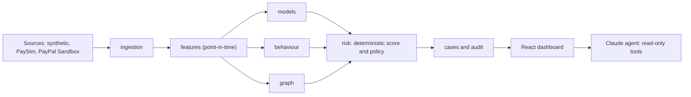

# SENTINEL AI

**Payment-fraud intelligence you can audit.** SENTINEL scores payments as they arrive, finds coordinated rings
through shared devices and merchants, explains every decision, and hands the final call to a human analyst. A
Claude-powered investigator answers questions, but only from evidence it actually retrieved.

Built for the PayPal AI Hackathon on a four-day deadline, and exercised against the real PayPal Sandbox.

> **Status: hackathon demo.** Synthetic data, SQLite, PayPal Sandbox only. See [What was and was not verified](#what-was-and-was-not-verified) before relying on any claim here.

## What it does

- **Scores every payment** from seven signals: a calibrated model probability, an anomaly score, behaviour against
  the account's own baseline, graph relationships, velocity, account history and merchant history.
  The combination is plain arithmetic from a versioned policy file, not another model.
- **Finds rings.** Accounts sharing a device, paying the same merchant, within minutes, are clustered and flagged.
- **Explains itself.** SHAP contributions for the model, named risk factors, behaviour reasons and the linked accounts.
- **Never decides alone.** Actions are recommendations (`ALLOW`, `MONITOR`, `REVIEW`, `VERIFY`, `HOLD_RECOMMENDED`).
  A hold is only suggested for a CRITICAL payment inside a flagged cluster. Nothing is blocked automatically.
- **Works cases.** Alerts become cases with notes, an approved action and an append-only audit log.
- **Investigates with Claude.** Ten read-only tools, every claim must cite an evidence id the tools returned, and
  replies that state fraud as fact or claim an action was taken are withheld.
- **Takes real PayPal Sandbox payments** through a signed webhook that is verified with PayPal before it is trusted.

It is built around a few rules: an anomaly is never proof of fraud; accuracy is never the headline metric
(recall and precision are always shown together); "suspicious value" is never called "fraud loss"; and data from
different sources is never blended.

## The dashboard

| Page | What you do there |
|---|---|
| **Overview** | Portfolio tiles, risk distribution (log or linear, click a level to filter), daily volume, model quality with its caveat |
| **Live Monitoring** | Start a replay, watch scored events arrive, latency and event-rate readouts, pause, jump to an investigation |
| **Investigation** | Work alerts into cases, see risk factors and SHAP bars, add notes, approve an action, resolve, generate an AI report |
| **Graph Explorer** | Flagged clusters and account neighbourhoods; click an account to expand it |
| **AI Investigator** | Ask questions; answers show the evidence they cite |

`Ctrl+K` opens a command palette to jump to any page or paste a transaction id. Viewers are read-only on every page,
and the server enforces that too.

## Quick start

Needs Python 3.11 and Node 24 (versions used). Windows commands shown.

```
py -3.11 -m venv .venv
.venv\Scripts\python -m pip install -r requirements.txt
npm install --prefix frontend
npm run build --prefix frontend
.venv\Scripts\python scripts\serve.py
```

The first run builds the demo world (about 3 to 4 minutes), then serves the API **and** the dashboard at
http://127.0.0.1:8000/ (API docs at `/docs`). Sign in as `ana` (analyst), `vic` (viewer) or `adm` (admin); the
generated passwords and JWT secret are in `.env.demo` (git-ignored, never printed). `--rebuild` resets the demo.

Optional integrations, in `.env` (git-ignored; see `.env.example`):

| Variable | Turns on |
|---|---|
| `ANTHROPIC_API_KEY` | The AI narrative in reports and the chat. Without it reports are deterministic and chat is off |
| `PAYPAL_CLIENT_ID`, `PAYPAL_CLIENT_SECRET`, `PAYPAL_WEBHOOK_ID` | The PayPal Sandbox webhook route. Needs a public URL: point a tunnel (cloudflared or ngrok) at `/paypal/webhook` |

`scripts/check_env.py` lists installed versions; `scripts/paypal_sandbox_check.py` creates a Sandbox order you approve in
a browser, and `scripts/live_claude_check.py` runs one real investigation.

**Tests:** `.venv\Scripts\python -m pytest` (407 tests, about 6 minutes on a slow laptop) and
`npm test --prefix frontend -- --run` (117 tests).

**Demo:** [docs/DEMO_SCRIPT.md](docs/DEMO_SCRIPT.md) is a four-minute walkthrough, including a warm-up step it needs.

## How it is built

A modular monolith: one FastAPI process, strict package boundaries, a React dashboard served by the same process.
Full diagrams are in [docs/ARCHITECTURE.md](docs/ARCHITECTURE.md).



Models are logistic regression, LightGBM and Isolation Forest, with isotonic or Platt calibration chosen on a
validation slice. One feature extractor serves training, batch scoring and live scoring, and features only ever
use history strictly before the event. Packages live in `backend/sentinel/`; the dashboard is in `frontend/`.

## Results

Measured on the demo world: synthetic data, 500 accounts over 30 days, 1.99% fraud, a chronological split, the model
trained on the first 70% only. **These are numbers on synthetic data I designed, not a guarantee on real traffic.**

| Measure | Result |
|---|---|
| LightGBM (the demo model, trained on the first 70% of history) on its own test slice | PR-AUC 0.739, recall 0.479, precision 0.767 |
| Full pipeline on validation and test rows, fraud reaching HIGH or above | 121 of 154 (79%) |
| HIGH-or-above precision on those rows | 89% (15 of 136 were not fraud) |
| Holds recommended on non-fraud rows | 0 |
| Legitimate-but-unusual purchases | all 5 stayed at MONITOR in the batch run |
| Planted rings flagged by the graph | 5 of 5, with no flagged cluster lacking a ring account |
| Ring events reaching HIGH or above in the live replay | 19 of 28 (68%); 86% once the cluster was flagged (first flag at ring event 8) |
| Live scoring latency | p50 81 ms, p95 162 ms on a quiet laptop; about 200 ms and 320 to 410 ms under heavy contention |

The batch rows (the 79%, 89%, holds, MONITOR and rings) come from the Day 2 evaluation on a 60/20/20 chronological split; the validation slice also fitted the calibrators and thresholds. The model and live-replay rows come from the demo build. The two setups use the same generator but different splits, so do not mix their numbers.

**What this means honestly:** about a fifth of planted fraud is missed (takeover bursts that look like legitimate
bursts, and the first ring payments before the shared-device pattern exists). Legitimate unusual purchases are
monitored, not escalated. Flagged clusters can carry one to four extra loosely attached accounts, so use a
cluster's evidence transactions, not its member list, for per-transaction decisions.

## What was and was not verified

| Area | Status |
|---|---|
| Claude reports | A real `claude-opus-5-5` investigation was run through the dashboard: model-written, citations validated, "suspicious, not confirmed fraud". One sample each for a report and a chat answer |
| Claude chat | Was broken until the first live call (a tool schema the API rejects); fixed and re-verified. Server-side refusal fallback: parameters are accepted, but a fallback has never been triggered |
| PayPal Sandbox | One real order created, approved by a Sandbox buyer and captured; one real signed webhook verified with PayPal and scored. **Refunds exist in code and have never been run.** Transaction Search is not built |
| Dashboard | All five pages driven in a browser against the real server and live Claude, as analyst and as viewer. Graph canvas rendering and click-to-expand confirmed through a scripted click; a real mouse click on a node is unconfirmed |
| PaySim | The loader is tested on a fixture only; no model was ever trained or evaluated on PaySim |
| Postgres, Docker | Postgres works through `DATABASE_URL` in principle and was never run. There is no Docker image |

[PROJECT_PROGRESS.md](PROJECT_PROGRESS.md) holds every measured number, every bug the independent reviews found, and
the deferred list. [docs/superpowers/day4-verification.md](docs/superpowers/day4-verification.md) is the dashboard
walk-through record.

## Security and safety

- Passwords are hashed with argon2; sessions are HS256 JWTs; roles are viewer, analyst and admin. The JWT secret must
  be at least 32 characters. Demo credentials are random and live only in a git-ignored file.
- Every record, metric, graph and agent tool is scoped to the user's business; two businesses with identical account
  ids never interact. The ground-truth label is never returned by any endpoint or tool.
- The audit log is append-only and admin-readable. Case state changes are a guarded state machine (a resolved case
  cannot be reopened).
- The webhook is authenticated by PayPal's signature, not a bearer token: the exact received bytes go to PayPal's
  verify API, only a literal `SUCCESS` is accepted, the certificate URL must be an https `paypal.com` host, bodies
  are capped at 64 KB, concurrent verifications are limited, and duplicates are dropped.
- The dashboard keeps its token in `sessionStorage` only, never in a URL, clears its cache when the signed-in user
  changes, and renders all server and model text as text, never as HTML.

## Known limitations

No per-IP rate limiting; scorer memory grows without bound over a long session; the live scorer handled about
3 events per second during replay on the development laptop, so a replay is slow to reach events deep in the stream;
transaction detail and the clusters list do full-table work (fine at demo scale, slow at PaySim scale). The full
deferred list is in [PROJECT_PROGRESS.md](PROJECT_PROGRESS.md).

## Layout

```
backend/sentinel/   ingestion  features  models  behaviour  graph  risk  live  paypal  agent  cases  dashboard  api
frontend/           React, TypeScript, Vite, Tailwind, Recharts, React Flow, Framer Motion
scripts/            serve.py  check_env.py  paypal_sandbox_check.py  live_claude_check.py
tests/              pytest suite (backend)       docs/   architecture, demo script, specs and plans
```
