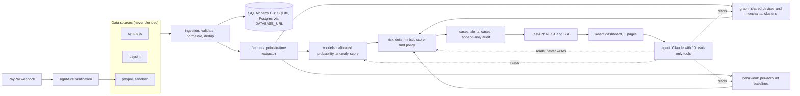
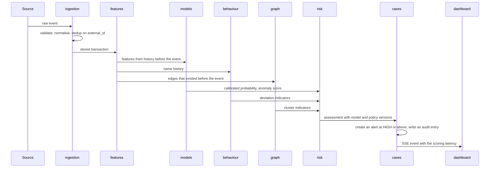
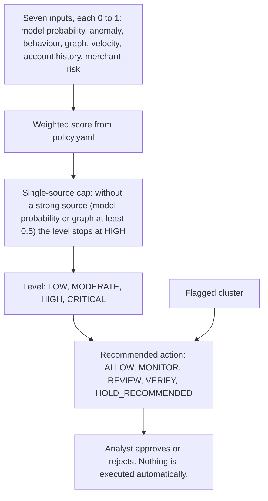
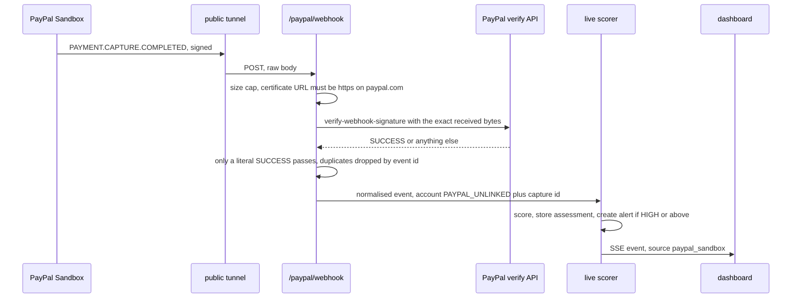
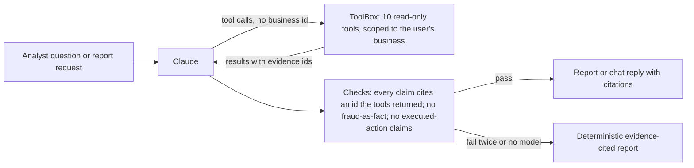

# SENTINEL AI — Architecture

SENTINEL is a modular monolith: one FastAPI process with strict package boundaries, a React dashboard
served by the same process, and optional Claude and PayPal Sandbox integrations. The diagrams below are
Mermaid and render on GitHub. Where a diagram shows a safety rule, the code that enforces it is named.

## 1. System overview

| Package (`backend/sentinel/`) | Responsibility |
|---|---|
| `ingestion/` | Schema, idempotent ingest with conflict detection, synthetic generator, PaySim loader |
| `features/` | The single feature extractor used by training, batch and live scoring (prevents training/serving skew) |
| `models/` | Logistic regression, LightGBM, Isolation Forest, calibration, SHAP, evaluation |
| `behaviour/` | Robust per-account baselines and deviation indicators |
| `graph/` | NetworkX account/device/merchant graph, Louvain clusters, four signals |
| `risk/` | Pure-Python deterministic scoring and `policy.yaml` (strictly validated) |
| `pipeline.py` | Two-pass, point-in-time batch scoring |
| `live/` | Incremental scorer, event bus, replay simulator |
| `paypal/` | Sandbox client (OAuth, orders, capture, refund) and webhook handling |
| `agent/` | Claude investigator: tools, report, chat, claim filters |
| `cases/` | Alerts, cases, notes, state machine, audit log |
| `dashboard/`, `api/` | Read-only dashboard queries; routes, auth, static serving |

## 2. What happens to one transaction

Batch and live scoring follow the same steps. Features use only history strictly before the event.

## 3. How the risk decision is made

- The score is arithmetic, not a model output. Only `calibrated_fraud_probability` is a probability, and the
  UI labels it that way. "Suspicious value" is the sum of HIGH and CRITICAL amounts, never a fraud loss.
- Weights are 0.35 model, 0.20 graph, 0.15 behaviour, 0.10 anomaly, 0.10 velocity, 0.05 account history,
  0.05 merchant risk. Level thresholds are 0.20 (MODERATE), 0.40 (HIGH) and 0.65 (CRITICAL).
- Anomaly, behaviour and velocity alone are never proof: without a strong source the level cannot exceed HIGH.
- `HOLD_RECOMMENDED` is only suggested for a CRITICAL transaction inside a flagged cluster (three or more of the
  four graph signals), never from a high score alone.
- The policy file is validated strictly: NaN, non-numeric or out-of-range values are rejected at load.

## 4. A real PayPal Sandbox payment

The capture webhook carries no payer identity, so an unlinked payment becomes its own pseudo-account instead of
being merged into one customer. PayPal events are scored in their own partition (see section 6).

## 5. The investigation agent's boundary

- The model never supplies a business id and cannot reach the ground-truth label; tool errors are results, not crashes.
- A chat reply that states fraud as fact, or claims an action was taken, is withheld and shown as a notice.
- Without an API key the report still works (deterministic) and chat is off.

## 6. Data separation

Scorer state is partitioned by business and data source (`"{business}|{source}"`). Synthetic, PaySim and PayPal
Sandbox rows never share features, baselines, clusters or the "newest event" clock. The dashboard has a data
source selector, and every aggregate, list and graph is filtered by it. All per-entity state is keyed by
business, so two businesses with the same account ids never interact (pinned by a two-business pipeline test).

## 7. Deployment

One process: `python scripts/serve.py` serves the API, the SSE stream and the built dashboard from the same
address. PayPal needs a public URL for webhooks, so use a tunnel (cloudflared or ngrok). SQLite is the tested
database; Postgres is supported through `DATABASE_URL` but was not run. There is no Docker image yet.
