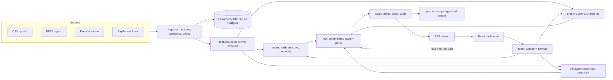
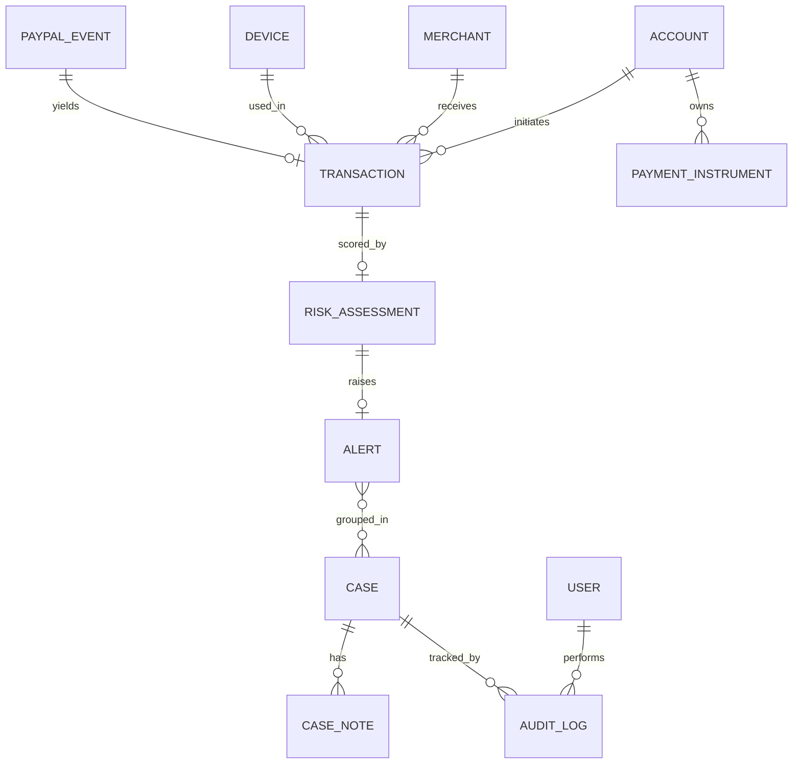
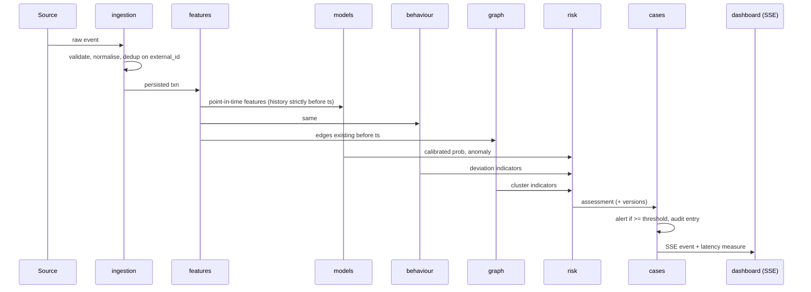
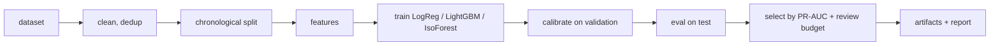
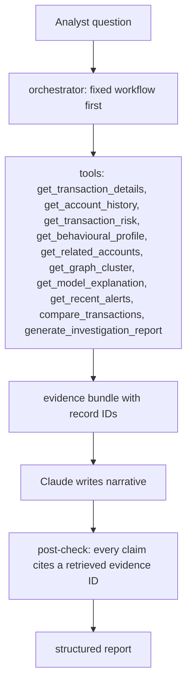

# SENTINEL AI — Phase 1 Design Spec

Date: 2026-11-09 · Status: **draft, awaiting user review** · Deadline: 4 days (PayPal AI Hackathon)

## 1. Purpose and success criteria

**Goal.** A reproducible, three-minute demo of a payment fraud *intelligence* platform that combines supervised ML, anomaly detection, a relationship graph, calibrated risk scoring, SHAP explanations and a tool-using Claude investigator, running on a real PayPal Sandbox flow and ending in human-approved actions.

**Success looks like**
1. A planted coordinated fraud ring is detected live: events stream in, scores and alerts appear, the graph reveals the cluster.
2. A *legitimate but unusual* transaction is flagged for review and is **not** labelled confirmed fraud.
3. The AI Investigator produces a structured report where every claim cites a retrieved evidence ID.
4. A real PayPal Sandbox payment travels webhook → verification → scoring → alert.
5. Everything runs on a laptop (7.9 GB RAM, no Docker, no Postgres installed).

**Non-negotiables (from the brief).** Deterministic risk maths; the LLM never invents evidence; an anomaly is never proof of fraud; no automatic blocking; synthetic, historical and PayPal-Sandbox data are never blended; accuracy is never the headline metric; the PayPal integration is not called complete until a real Sandbox workflow has been tested.

## 2. Scope: approach B (thin vertical slice, then deepen)

Phase 1 is **design only**. No application code is written until this spec is approved.

**Built:** synthetic generator + PaySim loader, ingestion, feature engine, LogReg + LightGBM + Isolation Forest, behaviour engine, NetworkX graph engine, risk engine, SHAP, Claude agent (10 tools), PayPal Sandbox (OAuth, Orders, capture, webhook), SSE live monitoring, auth/RBAC/audit, 5 dashboard pages, pytest suite, README, demo.

**Cut or deferred:** Random Forest, Autoencoder, GNN (stretch only); IEEE-CIS dataset (Kaggle login, opaque columns, large); Credit Card Fraud dataset (anonymised PCA features with no accounts or time structure suitable for graphs/behaviour); 7 of the 12 dashboard pages as standalone pages. Built: Overview, Live Monitoring, Graph Explorer, AI Investigator, plus an Investigation Workspace that replaces "Investigation Cases". Not built standalone: Transactions, Fraud Alerts, Account Intelligence, Behavioural Analytics, Model Performance, PayPal Integration, Settings. Their essentials fold into the five pages (transaction/alert tables in Overview and Live; model comparison table in Overview; account baseline and PayPal status panels in the Workspace). Docker image and Postgres are shipped as config but **untested on this machine**.

**Dataset rationale.** PaySim gives labelled mobile-money transfers with account IDs and time steps, suited to supervised training and behaviour baselines. It has no devices, no merchants (only `C`/`M` prefixed destinations), and a known label-leakage trap (`oldbalance`/`newbalance` columns). The **synthetic generator** supplies what PaySim lacks: devices, merchants, shared-device rings, legitimate-unusual cases. Models are trained and evaluated on a single dataset at a time; they are never pooled.

## 3. Architecture

Modular monolith: one FastAPI process, strict package boundaries, communication through Python interfaces, never through another module's tables. React frontend over REST plus SSE.



### Packages

```
sentinel-ai/
├── backend/sentinel/
│   ├── ingestion/   features/   models/   behaviour/   graph/
│   ├── risk/        agent/      paypal/   cases/       api/
├── frontend/        # React + TS + Vite + Tailwind + Recharts + React Flow + Framer Motion + Lucide
├── data/{raw,synthetic,paypal_sandbox}/   # kept separate
├── artifacts/       # saved models, eval reports
├── tests/  docs/  docker/
└── PROJECT_PROGRESS.md
```

Module mapping (brief's 13 → packages): ingestion + preprocessing + PayPal-ingest → `ingestion`; feature engine → `features`; ML + explainability → `models`; behavioural engine → `behaviour`; graph engine → `graph`; risk service → `risk`; AI agent → `agent`; alerts + audit/reporting → `cases`; PayPal service → `paypal`; dashboard → `frontend`; API → `api`.

### Rules
- `risk/` is pure Python. The agent can only *read* its outputs.
- `features/` is the single extractor for training, batch and live scoring (prevents training/serving skew).
- Every transaction carries `source ∈ {synthetic, paysim, paypal_sandbox}`; all dashboard metrics are filterable by it and never blend sources.

## 4. Data model

SQLAlchemy models; SQLite first, Postgres via one env var.



| Table | Key fields |
|---|---|
| transactions | id, external_id (unique), account_id, merchant_id, device_id?, amount, currency, ts, type, payment_method, status, geo?, label?, **source**, business_id |
| accounts | id (synthetic), created_at, business_id |
| merchants | id, category |
| devices | id (hashed identifier only) |
| payment_instruments | id, account_id, hashed token |
| risk_assessments | txn_id, ml_prob, anomaly, behaviour_dev, graph_risk, calibrated_prob, risk_score, level, action, factors (JSON), model_version, policy_version |
| alerts | id, txn_id, level, status |
| cases / case_notes | status, assignee, linked alerts; notes |
| audit_log | append-only; actor, action, target, ts, before/after |
| users | role (admin/analyst/viewer), business_id, argon2 hash |
| paypal_events | event_id (unique), verified, payload, processed_at |

Optional fields stay null where the source lacks them; **no graph edge is ever created from a null value.**

## 5. Per-transaction flow (batch and live identical)



Guards: no future data in features; chronological train/val/test; graph features use only prior edges; actions are *recommendations* (`ALLOW`, `MONITOR`, `REVIEW`, `VERIFY`, `HOLD_RECOMMENDED`) and nothing executes without analyst approval; every assessment stores model and policy versions for reproducibility.

## 6. Intelligence engines

### ML (`models/`)
- LogReg (baseline, coefficients as explanation), LightGBM (primary; lighter than XGBoost), Isolation Forest (unsupervised).
- Imbalance: class weights + threshold tuning; no SMOTE.
- Metrics: PR-AUC, precision, recall, F1, FPR, FNR, confusion matrix, precision at review threshold, inference latency. Accuracy is not headlined.
- Calibration (isotonic/Platt) fitted on the validation slice only; reliability curve in report.
- SHAP `TreeExplainer`; phrased as "contribution to model score", never causation.
- PaySim guard: drop leaking balance columns or prove via ablation that they don't leak.



### Behaviour (`behaviour/`)
Per-account robust baseline (median/MAD amount, hourly histogram, inter-arrival, known merchants, failure rate) on an exponentially weighted window. Indicators: robust amount z-score, burst vs baseline, new merchant, off-hours, failed-attempt streak. Transactions scored HIGH or above are excluded from baseline updates to avoid contamination. Deviation is an indicator, not a verdict.

### Graph (`graph/`)
NetworkX graph (account, merchant, device, instrument nodes; edges only where data exists). Connected components, degree centrality, Louvain communities, density, shared-identifier counts, temporal windowing. A cluster is flagged only when several signals co-occur (shared device, common merchant, tight time window, similar behaviour); a shared device alone is a weak indicator. Memory bound: operate on a rolling time window.

### Risk (`risk/`)
Inputs normalised to 0–1 by percentile against the training distribution, combined by a documented config-driven weighted function (`policy.yaml`, versioned). Only the ML probability is a calibrated probability; the composite is a **risk score** and the API exposes `calibrated_fraud_probability` as a separate field. Levels: Low / Moderate / High / Critical; thresholds derived from a cost analysis with the analyst review budget as the constraint. Same inputs always yield the same output; no LLM involved.

Example output:
```json
{"transaction_id":"TXN_1024","calibrated_fraud_probability":0.91,"risk_score":0.88,"risk_level":"HIGH",
 "risk_factors":["Unusual transaction frequency","Behavioural deviation","Suspicious account relationships"],
 "recommended_action":"REVIEW","model_version":"lgbm-…","policy_version":"…"}
```
(Illustrative, not a real result.)

## 7. Investigation agent (`agent/`)



- Claude via the Anthropic API behind a small provider interface; model ID in config (default `claude-sonnet-5-5`); needs `ANTHROPIC_API_KEY` from the user.
- No direct DB access. Tools return JSON containing IDs; claims citing an unretrieved ID are rejected.
- Report sections: Case ID, transaction details, risk assessment, model findings, behavioural findings, graph findings, supporting evidence, contradictory evidence, missing information, recommended next steps, confidence and limitations. "Suspicious" and "confirmed fraud" are distinct fields.

## 8. PayPal integration (`paypal/`) — Day 3, after the engines exist

- Flow: OAuth token → create Order → capture → webhook (`PAYMENT.CAPTURE.COMPLETED` etc.) → verify via PayPal `verify-webhook-signature` → dedup on `event_id` → normalise → score → alert.
- Retries with backoff; all calls logged; secrets backend-only in `.env`.
- UI labels which fields PayPal actually supplies (amount, status, payer ID, timestamps) versus demo-only fields (device, behaviour history). No claim of access to PayPal internal fraud signals.
- Response actions: internal flag and review only. Refund is an analyst-approved button on a captured payment, shown as *untested* unless run against Sandbox.
- Days 1–2 use recorded fixture payloads so the pipeline is testable; **live keys are wired in on Day 3**. Needs the user's Sandbox app Client ID/Secret, webhook ID, and a public tunnel (e.g. ngrok or cloudflared) for webhook delivery. Integration is declared complete only after a real Sandbox payment completes the loop.

## 9. API surface (v1)

| Method & path | Purpose |
|---|---|
| POST `/auth/login` | JWT login |
| POST `/ingest/transactions`, `/ingest/csv` | REST/CSV ingestion |
| POST `/simulate/start`, `/simulate/stop` | event simulator |
| GET `/transactions`, `/transactions/{id}` | list, detail (filter by source) |
| GET `/transactions/{id}/risk`, `/explanation` | assessment, SHAP |
| GET `/accounts/{id}`, `/accounts/{id}/profile` | history, behaviour baseline |
| GET `/graph/clusters`, `/graph/clusters/{id}`, `/graph/neighbours/{node}` | graph exploration |
| GET `/alerts`; POST `/alerts/{id}/status` | alert queue |
| GET/POST `/cases`, `/cases/{id}`, `/cases/{id}/notes`, `/cases/{id}/approve-action` | case workflow |
| POST `/agent/chat`, `/agent/report/{txn_id}` | investigator |
| GET `/stream/events` | SSE live feed |
| GET `/metrics/overview`, `/metrics/models` | dashboard metrics |
| POST `/paypal/orders`, `/paypal/orders/{id}/capture`, `/paypal/webhook` | PayPal |
| GET `/audit` | audit log (admin) |

Full OpenAPI is generated by FastAPI and committed to `docs/api/openapi.json` in Phase 2+.

## 10. Dashboard (5 pages)

Overview · Live Monitoring · Investigation Workspace (case, notes, audit, report, explanation, related entities) · Graph Explorer (React Flow, risk styling, cluster highlight, time filter, click-to-expand) · AI Investigator (chat). Dark navy fintech style, serif UI font per user preference (Astralaga or Quincy), every control wired to a real action. Suspicious value is always labelled "suspicious value", never "fraud loss".

## 11. Security

argon2 hashing, JWT, roles (admin/analyst/viewer), `business_id` filter on every query, pydantic validation, rate limiting, append-only audit log, webhook verification, secrets in `.env` only, synthetic identifiers, hashed device/instrument IDs.

## 12. Testing

pytest: preprocessing; features including a **leakage test** (no future data); risk determinism; graph clusters; behaviour indicators; duplicate handling; RBAC and tenant isolation; agent tool calling with a stubbed LLM, plus a citation-check test; PayPal ingestion with fixture payloads; alert generation; load test at varying volumes. ML report: time-aware validation, calibration, threshold analysis, documented limitations and dataset biases.

## 13. Four-day roadmap (each day ends runnable and verified)

| Day | Deliverable | Verification gate |
|---|---|---|
| 1 | This spec approved → repo scaffold, env check (Python version, wheels), synthetic generator + PaySim loader, ingestion, features, LogReg/LightGBM/IsoForest with time-aware eval | pytest green; real metrics report generated; leakage test passes |
| 2 | Graph engine, behaviour engine, risk engine + calibration, SHAP, auth/RBAC/audit/cases backend | Planted ring detected; legit-unusual case flagged but not "fraud"; risk determinism test |
| 3 | Claude agent + tools, SSE live stream, **PayPal Sandbox live** (OAuth, Orders, capture, webhook) | Real Sandbox payment completes webhook → score → alert; agent report passes citation check |
| 4 | 5 dashboard pages, test suite completion, README, diagrams export, demo video | End-to-end demo script runs from a clean start |

Risk register: Python 3.14 wheel gaps (fallback: 3.11/3.12 venv); 8 GB RAM (rolling graph window, LightGBM, no deep nets); Sandbox webhook needs a public tunnel; scope slip (cut order: Behaviour page polish → extra charts → rate limiting).

## 14. Limitations (to carry into the README)

Synthetic data reflects the generator's assumptions; PaySim is simulated and has no devices or merchants; PayPal exposes only what its API returns; composite risk score is not a probability; graph proximity is not guilt; Docker/Postgres paths are untested locally.

## 15. Inputs required from the user

1. `ANTHROPIC_API_KEY` (Day 3 at the latest).
2. PayPal Sandbox app Client ID/Secret and webhook ID (Day 3).
3. Permission to install Python packages and, if needed, a 3.11/3.12 interpreter.
